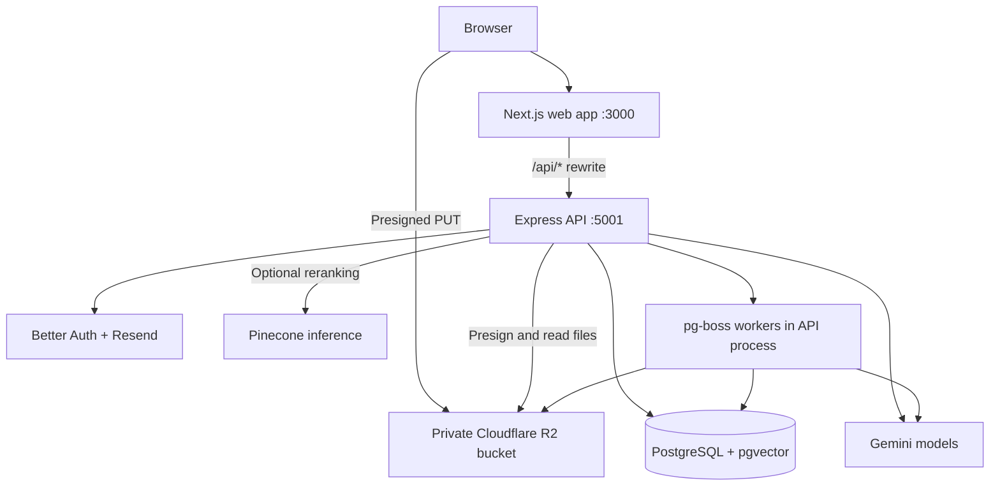

# AskDocs

AskDocs is a document chat application that turns uploaded files into a searchable conversation. Ask questions in plain English, receive streamed answers, and inspect the document excerpts behind numbered citations.

The project uses **retrieval-augmented generation (RAG)**: it extracts text from files, stores searchable chunks and embeddings in PostgreSQL, retrieves relevant passages for a question, and provides those passages to a Gemini model as answer context.

## Contents

- [Product overview](#product-overview)
- [Tech stack](#tech-stack)
- [Architecture](#architecture)
- [Repository structure](#repository-structure)
- [Prerequisites](#prerequisites)
- [Local setup](#local-setup)
- [Using AskDocs](#using-askdocs)
- [Environment variables](#environment-variables)
- [Development commands](#development-commands)
- [Database and background jobs](#database-and-background-jobs)
- [API overview](#api-overview)
- [Testing and code quality](#testing-and-code-quality)
- [Production build and deployment](#production-build-and-deployment)
- [Troubleshooting](#troubleshooting)
- [Current limitations](#current-limitations)
- [Contributing](#contributing)

## Product overview

AskDocs is built for finding information inside reports, research, policies, contracts, notes, and spreadsheet exports. A conversation can use multiple attached documents and retain context across follow-up questions.

### Features

| Area                | What is implemented                                                                                                                                        |
| ------------------- | ---------------------------------------------------------------------------------------------------------------------------------------------------------- |
| Document chat       | Ask questions about files attached to a conversation, or use general chat when document retrieval is unnecessary.                                          |
| Uploads             | Attach files through the composer or drag and drop; track upload and indexing progress and retry failed processing.                                        |
| Source citations    | Inspect numbered citations and source chips with document titles, excerpts, and PDF page numbers when available.                                           |
| Streaming           | Answers arrive incrementally over Server-Sent Events (SSE), with document-processing and answer status updates.                                            |
| Chat management     | Create, rename, delete, and revisit conversations; derive titles from the first prompt or attachment names and load older messages with cursor pagination. |
| Conversation memory | Background summaries preserve earlier context while keeping the model prompt bounded.                                                                      |
| Authentication      | Email/password signup, email verification, password reset, sessions, and optional Google sign-in.                                                          |
| Personalization     | Save response style, tone preferences, custom instructions, nickname, occupation, and profile context.                                                     |
| Workspace           | Responsive chat interface, collapsible sidebar, profile settings, and light, dark, or system theme.                                                        |
| Usage controls      | Shared per-user AI request and concurrency limits, embedding throttling, and optional reranking budgets.                                                   |

### Supported files

| Format     | Extension | Extraction behavior                                                            |
| ---------- | --------- | ------------------------------------------------------------------------------ |
| PDF        | `.pdf`    | Extracts text by page and retains page metadata for citations.                 |
| Word       | `.docx`   | Extracts document text.                                                        |
| Plain text | `.txt`    | Reads UTF-8 text and splits it into passages.                                  |
| Markdown   | `.md`     | Reads text and preserves heading context during chunking.                      |
| CSV        | `.csv`    | Converts rows into textual records.                                            |
| Excel      | `.xlsx`   | Reads worksheet rows and cached cell values, retaining sheet and row metadata. |

Current limits: **5 files per message/upload batch**, **10 MiB per file**, and **8,000 characters per message**. Extensions, MIME types, and file contents are validated. Scanned PDFs need OCR, which is not implemented. Excel formulas are not recalculated.

## Tech stack

Versions below describe the package manifests; `pnpm-lock.yaml` records the exact dependency graph.

| Layer                    | Technologies                                                                     | Role                                                                |
| ------------------------ | -------------------------------------------------------------------------------- | ------------------------------------------------------------------- |
| Web                      | Next.js 16.2, React 19.2, TypeScript 5.9                                         | App Router pages, session validation, and interactive chat.         |
| Styling and UI           | Tailwind CSS 4, shadcn/ui, Radix UI, Lucide, next-themes                         | Shared components, design tokens, icons, and theming.               |
| State and forms          | Zustand 5, React Hook Form 7, Zod 4                                              | Chat state, personalization, and validated forms.                   |
| Answer rendering         | Streamdown                                                                       | Markdown rendering during streamed responses.                       |
| API                      | Express 5, TypeScript, Zod 4                                                     | Authenticated endpoints, validation, and SSE streaming.             |
| Authentication and email | Better Auth 1.6, Resend, React Email                                             | Sessions, verification, password reset, OAuth, and email templates. |
| Database                 | PostgreSQL, pgvector, Drizzle ORM, postgres.js                                   | Application data, vector search, full-text search, and migrations.  |
| AI                       | LangChain, Google Gemini chat and embedding models                               | Routing, embeddings, answers, and summaries.                        |
| Retrieval                | PostgreSQL full-text search, reciprocal rank fusion, optional Pinecone reranking | Combine semantic and keyword matches and rank evidence.             |
| File storage             | Cloudflare R2, AWS S3 SDK                                                        | Private file storage and presigned browser uploads.                 |
| Background work          | pg-boss 12                                                                       | PostgreSQL-backed ingestion, summary, and cleanup queues.           |
| API operations           | Pino, Helmet, CORS, express-rate-limit, Swagger UI                               | Logging, request controls, security headers, and development docs.  |
| Monorepo                 | pnpm 10.34.5, Turborepo 2                                                        | Workspaces, task orchestration, and caching.                        |
| Quality tools            | ESLint 9, Prettier 3, Husky, lint-staged, Node test runner, tsx                  | Linting, formatting, Git hooks, types, and tests.                   |

Pinecone is used only for optional reranking. **Document vectors live in PostgreSQL with pgvector**; a Pinecone index is not required.

## Architecture



### Upload and indexing

1. The authenticated client requests upload URLs. The API creates document records and returns short-lived presigned URLs.
2. The browser uploads bytes directly to R2, then calls the completion endpoint.
3. The API verifies the uploaded size and queues ingestion with pg-boss.
4. A worker validates file contents, extracts text, and splits it into passages. The chunk target is 1,024 characters with up to 128 characters of overlap.
5. Gemini generates 768-dimensional embeddings. Chunks, embeddings, and source metadata are saved in PostgreSQL, and the document becomes ready.

Document states are `uploading → pending → processing → ready`, with `failed` used when processing cannot complete. Progress can report embedding, waiting for capacity, and saving stages.

### Question and answer

1. The API checks the session, ownership, and per-user AI limits, then saves the user message.
2. Routing selects general chat or document retrieval using the question and conversation context. Newly attached documents are allowed to finish indexing before answering.
3. Retrieval searches the user's ready documents associated with that conversation. The default `hybrid_rerank` mode combines vector similarity and PostgreSQL full-text results using reciprocal rank fusion.
4. Optional Pinecone inference reranks candidates. Missing credentials, unavailable budget, timeouts, or provider errors fall back to local BM25 reranking.
5. Up to 8 evidence passages are selected within the evidence budget and sent to the answer model with recent history, the stored summary, and personalization preferences.
6. Tokens stream to the client. The completed assistant message and valid citations are saved, and a summary job is queued when history crosses the configured threshold.

Embedding caches reduce repeated document embedding work. Retrieval cache keys include the user and document versions, and access is rechecked before cached evidence is returned.

## Repository structure

```text
.
├── apps/
│   ├── web/                         # Next.js frontend
│   │   ├── app/                     # Landing, auth, and protected chat routes
│   │   ├── components/              # Landing sections, chat UI, app components
│   │   ├── lib/                     # API clients, sessions, stores, streaming
│   │   ├── hooks/                   # App hooks
│   │   ├── tests/                   # Frontend logic tests
│   │   ├── proxy.ts                 # Optimistic route guard
│   │   ├── next.config.js           # /api rewrite and shared UI transpilation
│   │   └── DESIGN.md                # Visual design reference
│   └── api/                         # Express backend
│       ├── src/
│       │   ├── config/              # Environment and middleware configuration
│       │   ├── controllers/         # HTTP handlers
│       │   ├── core/                # Errors, responses, validation schemas
│       │   ├── db/                  # Drizzle client and application schemas
│       │   ├── docs/                # OpenAPI specification
│       │   ├── emails/              # Verification and reset email templates
│       │   ├── lib/                 # Auth, R2 storage, pg-boss setup
│       │   ├── middlewares/         # Auth, limits, validation, logging, errors
│       │   ├── routes/              # Route definitions
│       │   ├── services/            # Chats, documents, AI admission, RAG
│       │   │   └── rag/             # Ingestion, retrieval, streaming, summaries
│       │   ├── scripts/             # Database reset helpers
│       │   ├── app.ts               # Express app factory
│       │   └── index.ts             # Server and worker startup
│       ├── drizzle/                 # SQL migrations and metadata
│       └── env.example              # API environment template
├── packages/
│   ├── ui/                          # @repo/ui: components, hooks, theme CSS
│   ├── eslint-config/               # @repo/eslint-config: shared lint presets
│   ├── prettier-config/             # @repo/prettier-config: shared formatting
│   └── typescript-config/           # @repo/typescript-config: TS presets
├── .husky/                          # Commit and push hooks
├── pnpm-workspace.yaml              # Workspaces and package-age configuration
└── turbo.json                       # Task dependencies and cache outputs
```

## Prerequisites

- **Node.js 22.12 or newer.** The root manifest still declares `>=18.12`, but current dependencies require newer Node: `pg-boss` requires `>=22.12.0` and `file-type` requires `>=22`.
- **pnpm 10.34.5**, matching the root `packageManager` field.
- **PostgreSQL with pgvector available**, and a role that can apply migrations and initialize pg-boss database objects. Use a managed database such as Neon or a local pgvector-enabled instance.
- A **Google Gemini API key** with access to the configured chat and embedding models.
- A **private Cloudflare R2 bucket** and S3 API credentials for uploads and processing.
- A **Resend API key and permitted sender address** for verification and reset emails.
- Optional: Google OAuth credentials and a Pinecone API key for reranking.

Redis and a separate vector database are not required. Background jobs and vector search both use PostgreSQL.

## Local setup

Run commands from the repository root unless another directory is specified.

### 1. Clone and install

```sh
git clone https://github.com/25f3005585/ai-document-rag-app.git
cd ai-document-rag-app

# If the matching pnpm version is not installed:
npm install --global pnpm@10.34.5

pnpm install
```

Installation runs the root `prepare` script to install Husky hooks. The workspace enforces a seven-day minimum package release age with `minimumReleaseAge: 10080`.

### 2. Configure the API

```sh
cp apps/api/env.example apps/api/.env

# Generate a value for BETTER_AUTH_SECRET:
openssl rand -base64 32
```

Edit `apps/api/.env` and replace the template values for:

- `DATABASE_URL` and `DATABASE_URL_DIRECT`.
- `BETTER_AUTH_SECRET` and `GEMINI_API_KEY`.
- `RESEND_API_KEY` and `EMAIL_FROM`.
- `R2_ACCOUNT_ID`, `R2_ACCESS_KEY_ID`, `R2_SECRET_ACCESS_KEY`, and `R2_BUCKET_NAME`.

Keep the local URLs aligned:

```dotenv
PORT=5001
NODE_ENV=development
BETTER_AUTH_URL=http://localhost:3000
WEB_URL=http://localhost:3000
ALLOWED_ORIGINS=http://localhost:3000,http://localhost:3001
```

For Neon, use the pooled connection for `DATABASE_URL` and the direct, non-pooler connection to the same database for `DATABASE_URL_DIRECT`. pg-boss uses the direct connection for polling and maintenance. Without a pooler, both can use the same connection string. If `DATABASE_URL_DIRECT` is omitted, it falls back to `DATABASE_URL`.

### 3. Configure the web app

There is currently no checked-in web `.env.example`. Create `apps/web/.env.local`:

```sh
cat > apps/web/.env.local <<'EOF'
NEXT_PUBLIC_API_URL=http://localhost:5001
NEXT_PUBLIC_WEB_URL=http://localhost:3000
NEXT_PUBLIC_GOOGLE_AUTH_ENABLED=false
EOF
```

`NEXT_PUBLIC_API_URL` is the Express upstream for Next.js rewrites and server-side session lookups. Browser application requests use the web origin's `/api/*` paths. Auth runs on Express but is reached through Next.js so cookies are set on the web host.

### 4. Prepare storage and email

Create a private R2 bucket and configure CORS to permit the frontend origin. This local policy matches the storage helper's intended configuration:

```json
[
  {
    "AllowedOrigins": ["http://localhost:3000", "http://localhost:3001"],
    "AllowedMethods": ["PUT", "GET", "HEAD"],
    "AllowedHeaders": ["*", "content-type", "content-length"],
    "ExposeHeaders": ["ETag", "Content-Length"],
    "MaxAgeSeconds": 3600
  }
]
```

R2 credentials need access to upload, read, inspect, and delete objects in the selected bucket. Bucket verification and CORS helpers exist in the API, but startup does not call them; configure the bucket explicitly.

For Resend, set `EMAIL_FROM` to a sender your account can use, typically on a verified domain. Replace the template sender. Email/password login requires email verification, so working email delivery is part of signup.

### 5. Apply database migrations

On a fresh database:

```sh
pnpm --filter api db:migrate
```

The migrations create tables and indexes, enable `vector`, and install SQL functions for AI request limits and reranking budgets. If the application role cannot create extensions, have the database owner enable pgvector first:

```sql
CREATE EXTENSION IF NOT EXISTS vector;
```

Use migrations for a complete bootstrap. `db:push` synchronizes the Drizzle schema but **does not install custom SQL functions**. For a database previously created with `db:push`, reconcile migration history before applying the migration sequence; use a fresh development database if no data needs to be retained.

### 6. Start the application

```sh
pnpm dev
```

| Service                      | Local URL                                                        |
| ---------------------------- | ---------------------------------------------------------------- |
| Web app                      | [http://localhost:3000](http://localhost:3000)                   |
| Chat workspace               | [http://localhost:3000/chats](http://localhost:3000/chats)       |
| Express API                  | [http://localhost:5001](http://localhost:5001)                   |
| Swagger UI, development only | [http://localhost:5001/api-docs](http://localhost:5001/api-docs) |

The API starts pg-boss workers after connecting to PostgreSQL. No separate worker command is needed.

Check the API in another terminal:

```sh
curl http://localhost:5001/health/live
curl http://localhost:5001/health
curl http://localhost:5001/health/ready
```

Liveness confirms the HTTP process responds. Health checks PostgreSQL and reports process metrics; readiness also applies a memory threshold. These endpoints do not validate Gemini, R2, or email delivery.

### Optional: Google sign-in

1. Set `GOOGLE_CLIENT_ID` and `GOOGLE_CLIENT_SECRET` in `apps/api/.env`.
2. Register `http://localhost:3000/api/auth/callback/google` as an authorized OAuth redirect URI.
3. Set `NEXT_PUBLIC_GOOGLE_AUTH_ENABLED=true` in `apps/web/.env.local`.
4. Restart both apps.

The backend enables Google only when both credentials exist; the web flag controls the sign-in button.

## Using AskDocs

1. Open the web app, create an account, and follow the verification email link. Google sign-in is also available when configured.
2. Open `/chats` and start a conversation.
3. Attach a supported file and watch upload/indexing progress. A question submitted during indexing can wait for the attachment.
4. Ask a specific question, such as “What are the main findings?” or “Which section describes the renewal period?”
5. Inspect source chips for excerpts and available page information.
6. Ask follow-up questions in the same conversation to reuse its document context.
7. Use account settings to personalize answers, edit your profile, or change the theme.

## Environment variables

Keep API secrets in `apps/api/.env` and web configuration in `apps/web/.env.local`. `NEXT_PUBLIC_` values are public and must not contain secrets.

### API: services and authentication

| Variable                      | Requirement / default        | Purpose                                                           |
| ----------------------------- | ---------------------------- | ----------------------------------------------------------------- |
| `PORT`                        | `5001`                       | Express listening port.                                           |
| `NODE_ENV`                    | `development`                | Production middleware and development docs/logging.               |
| `DATABASE_URL`                | Required                     | PostgreSQL application connection.                                |
| `DATABASE_URL_DIRECT`         | Falls back to `DATABASE_URL` | Direct connection for pg-boss.                                    |
| `DATABASE_POOL_MAX`           | `10`                         | Maximum postgres.js application connections.                      |
| `DATABASE_PREPARE_STATEMENTS` | `false`                      | Opt-in prepared-query support; verify pooler compatibility first. |
| `R2_ACCOUNT_ID`               | Required for files           | Cloudflare account identifier.                                    |
| `R2_ACCESS_KEY_ID`            | Required for files           | R2 S3 API access key.                                             |
| `R2_SECRET_ACCESS_KEY`        | Required for files           | R2 S3 API secret.                                                 |
| `R2_BUCKET_NAME`              | Required for files           | Private document bucket.                                          |
| `BETTER_AUTH_SECRET`          | Required                     | Strong random authentication secret.                              |
| `BETTER_AUTH_URL`             | `http://localhost:3000`      | Public web origin for auth URLs and callbacks.                    |
| `WEB_URL`                     | `http://localhost:3000`      | Frontend origin trusted by auth.                                  |
| `ALLOWED_ORIGINS`             | Comma-separated origins      | CORS allowlist; the template includes ports 3000 and 3001.        |
| `GOOGLE_CLIENT_ID`            | Optional                     | Google OAuth client ID.                                           |
| `GOOGLE_CLIENT_SECRET`        | Optional                     | Google OAuth client secret.                                       |
| `RESEND_API_KEY`              | Required                     | Verification and reset email delivery.                            |
| `EMAIL_FROM`                  | Set to your permitted sender | Email sender name and address.                                    |

`DATABASE_URL`, `GEMINI_API_KEY`, `BETTER_AUTH_SECRET`, and `RESEND_API_KEY` are required when the API environment module loads. R2 values are checked when storage is used.

### API: AI and retrieval

| Variable                         | Default / template value         | Purpose                                                     |
| -------------------------------- | -------------------------------- | ----------------------------------------------------------- |
| `GEMINI_API_KEY`                 | Required                         | Chat and embedding credentials.                             |
| `GEMINI_CHAT_MODEL`              | `gemini-2.5-flash`               | Main answer model.                                          |
| `GEMINI_FAST_MODEL`              | `gemini-2.5-flash-lite`          | Routing and summary work.                                   |
| `GEMINI_EMBED_MODEL`             | Template: `gemini-embedding-001` | Embedding model; must support 768-dimensional output.       |
| `GEMINI_EMBED_INPUTS_PER_MINUTE` | `96`                             | Background document embedding inputs per minute.            |
| `RAG_RETRIEVAL_MODE`             | `hybrid_rerank`                  | `vector`, `hybrid`, or `hybrid_rerank`.                     |
| `PINECONE_API_KEY`               | Optional                         | Remote reranking; local BM25 is the fallback.               |
| `PINECONE_RERANK_BUDGET_SCOPE`   | `askdocs-bge-reranker-v2-m3`     | Shared budget scope across API processes and key rotations. |
| `AI_CHAT_REQUESTS_PER_MINUTE`    | `10`                             | Per-user requests in a rolling minute.                      |
| `AI_CHAT_REQUESTS_PER_DAY`       | `200`                            | Per-user requests in a rolling 24 hours.                    |
| `AI_CHAT_CONCURRENT_REQUESTS`    | `2`                              | Concurrent answer limit per user.                           |
| `AI_MAX_OUTPUT_TOKENS`           | `3072`                           | Main answer ceiling, including provider thinking tokens.    |

Set `GEMINI_EMBED_MODEL` explicitly: the example file uses `gemini-embedding-001`, while the code fallback is `gemini-embedding-2`. Ingestion and query embeddings must use the same model and dimensionality. Changing the model requires re-embedding existing documents so vectors remain comparable.

The application's optional Pinecone reranking budget allows up to 500 calls per sliding 31 days and 60 per minute per scope. These are application limits implemented in SQL, not provider plan or pricing guarantees.

### API: request and health controls

| Variable                     | Default   | Purpose                                                 |
| ---------------------------- | --------- | ------------------------------------------------------- |
| `RATE_LIMIT_WINDOW_MS`       | `900000`  | IP limiter window in milliseconds.                      |
| `RATE_LIMIT_MAX_REQUESTS`    | `400`     | General IP allowance per window.                        |
| `REQUEST_TIMEOUT_MS`         | `60000`   | Request timeout before a response starts.               |
| `READINESS_MEMORY_THRESHOLD` | `90`      | Heap usage percentage above which readiness fails.      |
| `SECURITY_MAX_PAYLOAD_SIZE`  | `5242880` | Production security monitor payload threshold in bytes. |

### Web

| Variable                          | Default                 | Purpose                                       |
| --------------------------------- | ----------------------- | --------------------------------------------- |
| `NEXT_PUBLIC_API_URL`             | `http://localhost:5001` | Rewrite upstream and server-side session API. |
| `NEXT_PUBLIC_WEB_URL`             | `http://localhost:3000` | Public web origin for auth and callback URLs. |
| `NEXT_PUBLIC_GOOGLE_AUTH_ENABLED` | Disabled unless `true`  | Displays the Google sign-in button.           |

Restart development servers after changing environment values. Set web public variables before a production build because they are used in the built app.

## Development commands

| Command             | Description                                                          |
| ------------------- | -------------------------------------------------------------------- |
| `pnpm dev`          | Start web and API development servers.                               |
| `pnpm build`        | Build workspaces with build scripts.                                 |
| `pnpm start`        | Start production servers; Turbo runs their build dependencies first. |
| `pnpm lint`         | Run strict ESLint checks with caching.                               |
| `pnpm format`       | Rewrite formatting in packages with a format script.                 |
| `pnpm format:check` | Check formatting without rewriting source.                           |
| `pnpm check-types`  | Check types; web runs `next typegen` before TypeScript.              |
| `pnpm test`         | Run API and web test scripts through Turbo.                          |
| `pnpm validate`     | Run lint, formatting checks, and type checks as the pre-merge gate.  |

`validate` does not include tests or the build. It does not auto-fix source; tooling may still write caches or generated types. Root formatting tasks delegate to package scripts, so check a root README edit explicitly with `pnpm exec prettier --check README.md`.

Run one workspace or task:

```sh
pnpm exec turbo run dev --filter=web
pnpm exec turbo run dev --filter=api

pnpm --filter web build
pnpm --filter api build
pnpm --filter api clean

pnpm --filter web test
pnpm --filter api test
```

Turbo caches build outputs and ESLint caches. Server tasks are persistent and uncached. Build, lint, and type-check tasks respect upstream workspace dependencies.

## Database and background jobs

### Data model

PostgreSQL stores auth users/sessions/accounts, chats, messages, rolling summaries, document metadata and associations, chunks and vectors, citations, personalization, embedding caches, reranking usage, and AI request reservations. Search uses HNSW vector indexes and GIN full-text indexes. File bytes live in R2, and pg-boss maintains its own queue objects in PostgreSQL.

### Database commands

```sh
pnpm --filter api db:generate  # Generate SQL after editing Drizzle schemas
pnpm --filter api db:migrate   # Apply checked-in migrations
pnpm --filter api db:push      # Schema sync; excludes custom SQL functions
pnpm --filter api db:studio    # Open the Drizzle database browser
```

Review generated SQL before applying it. Changes needing functions or other SQL-only behavior must include a custom migration.

Two destructive development reset helpers also exist:

| Command                            | Effect                                                                                                                                                      |
| ---------------------------------- | ----------------------------------------------------------------------------------------------------------------------------------------------------------- |
| `pnpm --filter api db:clear`       | Truncates auth tables and cascades into related app data, keeping the schema.                                                                               |
| `pnpm --filter api db:clear:chats` | Truncates chats, messages, documents, chunks, citations, links, and reranking usage; keeps auth, preferences, embedding cache, and AI request reservations. |

These helpers delete database rows, **not R2 objects or pg-boss jobs**. Stop the API before a development reset and handle storage/queue cleanup separately if needed. Both refuse to run with `NODE_ENV=production` unless explicitly forced.

### Queues

| Queue                  | Responsibility                                                                                                                                         |
| ---------------------- | ------------------------------------------------------------------------------------------------------------------------------------------------------ |
| `ingest-document`      | Validate, extract, chunk, embed, and save documents; retry transient failures.                                                                         |
| `summarize-chat`       | Update summaries while tracking a stable message cursor.                                                                                               |
| `stale-upload-cleanup` | Every 10 minutes: remove uploads incomplete for over an hour, recover interrupted processing, requeue pending documents, and prune AI request records. |

Workers run inside Express. Keep the API process running while files are indexing or summaries are queued.

## API overview

Browser clients use the web origin's `/api/*` paths. Express registers the following routes. Chat, document, and profile routes require a session and enforce resource ownership where applicable.

| Method            | Path                          | Purpose                                                              |
| ----------------- | ----------------------------- | -------------------------------------------------------------------- |
| `GET`             | `/health`                     | Database health and process metrics.                                 |
| `GET`             | `/health/live`                | Process liveness.                                                    |
| `GET`             | `/health/ready`               | Database and memory readiness.                                       |
| Various           | `/api/auth/*`                 | Better Auth signup, login, verification, reset, sessions, and OAuth. |
| `GET`             | `/api/me`                     | Current user profile.                                                |
| `GET`, `PUT`      | `/api/me/preferences`         | Read or replace personalization.                                     |
| `POST`, `GET`     | `/api/chats`                  | Create or list conversations.                                        |
| `PATCH`, `DELETE` | `/api/chats/:id`              | Rename or delete a conversation.                                     |
| `POST`            | `/api/chats/:id/title`        | Generate a title.                                                    |
| `GET`             | `/api/chats/:id/documents`    | List a conversation's documents.                                     |
| `GET`             | `/api/chats/:id/messages`     | Load messages; `?before=<message-id>` loads older pages.             |
| `POST`            | `/api/chats/:id/messages`     | Submit a message and stream an answer.                               |
| `POST`            | `/api/documents/uploads`      | Create document records and presigned URLs.                          |
| `GET`             | `/api/documents`              | List the user's documents.                                           |
| `GET`, `DELETE`   | `/api/documents/:id`          | Read document status or delete the document and stored file.         |
| `POST`            | `/api/documents/:id/complete` | Verify upload and queue ingestion.                                   |
| `POST`            | `/api/documents/:id/retry`    | Retry failed ingestion.                                              |

Message pages contain up to 15 messages and pagination metadata. Resource IDs and the `before` cursor are UUIDs.

### Request examples

Request upload URLs with file metadata:

```json
{
  "files": [
    {
      "name": "report.pdf",
      "size": 245760,
      "mimeType": "application/pdf"
    }
  ]
}
```

Send a message with optional attachments:

```json
{
  "content": "What are the main findings in this report?",
  "documentIds": ["11111111-1111-4111-8111-111111111111"]
}
```

Replace the ID with a document owned by the signed-in user. A message requires text or at least one document; duplicate document IDs are rejected.

### Responses and streaming

Normal app endpoints return `success`, `message`, `data`, and `metadata` containing a timestamp and trace ID. Failures return `success: false`, a message, an `error` object with code and trace ID, and `statusCode`. Better Auth handles its own response formats.

Message submission uses `text/event-stream` after successful preparation:

| Event     | Meaning                                                                      |
| --------- | ---------------------------------------------------------------------------- |
| `meta`    | Saved user message ID and documents currently processing.                    |
| `status`  | `reading_documents` or `answering`, with document IDs and optional versions. |
| `sources` | Source numbers, document IDs, titles, and page numbers.                      |
| `token`   | Incremental answer text.                                                     |
| `done`    | Saved assistant message ID and final citations with excerpts.                |
| `error`   | Error code and message for a failed stream.                                  |

Streams send heartbeat comments every 15 seconds and have a five-minute timeout. Clients must handle HTTP failures before streaming and `error` events after streaming starts.

Swagger UI is available outside production, but the current OpenAPI file documents only health endpoints. Route files and validation schemas describe the complete implemented API.

## Testing and code quality

Tests use Node's built-in runner through `tsx`. API tests live alongside code as `*.test.ts`; web logic tests live in `apps/web/tests`. Coverage includes ingestion validation, chunking, retrieval, reranking, citations, summaries, streaming, progress, chat state, and pagination.

```sh
pnpm validate
pnpm test
pnpm exec prettier --check README.md
pnpm build
```

The repo uses strict TypeScript with `noUncheckedIndexedAccess`, ESLint typed rules, sorted imports, and complexity/size limits. Shared Prettier settings use semicolons, single quotes, trailing commas, two spaces, and a 100-character print width.

| Husky hook | Action                                                          |
| ---------- | --------------------------------------------------------------- |
| Pre-commit | Format staged files with lint-staged, then run `pnpm validate`. |
| Pre-push   | Run `pnpm build`.                                               |

No CI workflow is checked in. Run the quality gate, tests, and build locally before submitting changes.

## Production build and deployment

```sh
pnpm build
pnpm start
```

Web uses `next build` / `next start`; the API compiles into `apps/api/dist` and runs `node dist/index.js`. The root start task declares a build dependency, so it can trigger builds before starting servers.

1. Provision PostgreSQL with pgvector, a private R2 bucket, Gemini access, and email delivery.
2. Configure each app's environment in its deployment service. Set `NODE_ENV=production` for the API and use HTTPS public URLs.
3. Set `NEXT_PUBLIC_API_URL` to the API address reachable by the Next.js server. Set `NEXT_PUBLIC_WEB_URL`, `WEB_URL`, and `BETTER_AUTH_URL` to the public frontend origin.
4. Apply migrations as a release step before serving the updated app.
5. Build and start each app in its workspace, or use the root scripts on one host.
6. Update API CORS, R2 CORS, and any Google OAuth redirect URI for the public frontend origin.
7. Keep Express running for pg-boss workers. Hosting and proxies must support long-lived SSE requests without response buffering.

Production mode enables secure auth cookies, one-hop proxy trust, security monitoring, and JSON logs. Swagger UI is disabled. Health/readiness cover PostgreSQL and process state rather than all integrations.

## Troubleshooting

| Problem                                                    | What to check                                                                                                      |
| ---------------------------------------------------------- | ------------------------------------------------------------------------------------------------------------------ |
| Engine error during install                                | Use Node 22.12+ and pnpm 10.34.5; the root Node declaration is older than current dependency requirements.         |
| API reports a missing variable                             | Copy `apps/api/env.example`, replace required values, and use workspace scripts so dotenv reads the API directory. |
| `vector` type/extension unavailable                        | Use PostgreSQL with pgvector installed and enable the extension with a permitted role.                             |
| `reserve_ai_chat_request` or `reserve_rerank_call` missing | Apply custom SQL migrations; `db:push` does not install these functions.                                           |
| Existing tables conflict with migrations                   | Check for prior `db:push` setup; reconcile history or use a fresh development database.                            |
| pg-boss fails or jobs stay pending                         | Check the direct database URL, schema privileges, and worker startup logs; keep Express alive.                     |
| Login blocked after signup                                 | Verify the email; check the Resend key and sender if delivery fails.                                               |
| Login loops or cookies missing                             | Align frontend URLs and use the web `/api/auth/*` rewrite. Use one hostname consistently.                          |
| Google sign-in missing or failing                          | Set both OAuth credentials, enable the web flag, and match the registered redirect URI.                            |
| Upload CORS error or 403                                   | Check bucket CORS, credentials, content type, and presigned URL expiry (10 minutes).                               |
| Extraction fails                                           | Check extension/MIME/content agreement, file size, and extractable PDF text. OCR is unavailable.                   |
| Embedding progress says waiting                            | Check Gemini capacity and embedding allowance; indexing can wait or retry under quota pressure.                    |
| Model or embedding errors                                  | Check Gemini key, model access, quotas, and 768-dimensional embedding support.                                     |
| HTTP 429 on chat                                           | Check IP limits and per-user minute, rolling 24-hour, and concurrency limits.                                      |
| Pinecone unavailable                                       | Local BM25 reranking is the fallback; inspect API logs for the reason.                                             |
| Answer arrives all at once                                 | Check proxy buffering and SSE support; the API disables event-stream compression.                                  |
| Readiness returns 503                                      | Check PostgreSQL connectivity and heap usage against the readiness threshold.                                      |
| Formatting gate fails                                      | Format affected files, rerun `pnpm validate`, and check root files separately when needed.                         |

## Current limitations

- Scanned/image-only PDFs, image uploads, legacy `.doc` / `.xls` files, and OCR are unsupported.
- Spreadsheet extraction reads cached values; it does not execute formulas or provide a calculation engine.
- Retrieval selects passages within a context budget rather than including every document in every request.
- Upload counts, file sizes, message lengths, output tokens, and provider quotas bound requests.
- API and workers share one process; a separate worker deployment entry point is not provided.
- OpenAPI documentation covers health routes only.
- No Docker/Compose configuration or CI workflow is included.
- No root license file is included. The API package's `ISC` metadata does not establish a repository-wide license.

## Contributing

1. Read [AGENTS.md](./AGENTS.md) and relevant app instructions before changing code.
2. For web UI, read [apps/web/DESIGN.md](./apps/web/DESIGN.md) and [apps/web/AGENTS.md](./apps/web/AGENTS.md). The visual reference is a warm, document-focused workspace.
3. Put reusable primitives in `packages/ui` and app features in `apps/web`. Import shared components through `@repo/ui` exports.
4. For API work, follow [apps/api/AGENTS.md](./apps/api/AGENTS.md). Separate routes, controllers, validation, and business logic; API code uses ESM with `.js` import extensions.
5. Include migrations for schema changes and custom SQL behavior.
6. Run `pnpm validate`, relevant tests, and `pnpm build`, and update docs when setup or behavior changes.

Add shared UI components from the root with:

```sh
pnpm dlx shadcn@latest add <component-name> -c apps/web
```

The CLI routes primitives to `packages/ui` and app blocks to `apps/web`. Keep both `components.json` files aligned for style, base color, and icon library.
